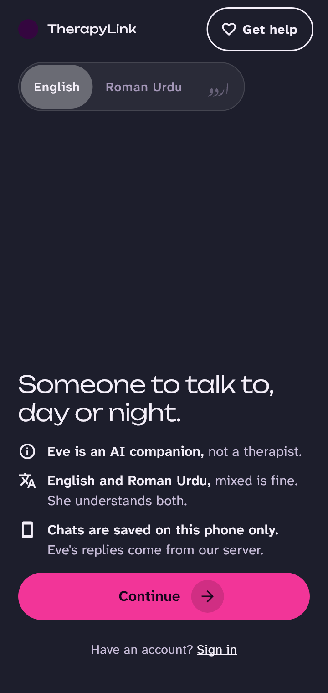
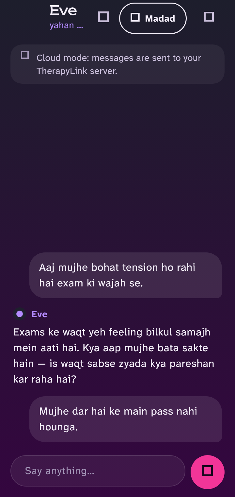
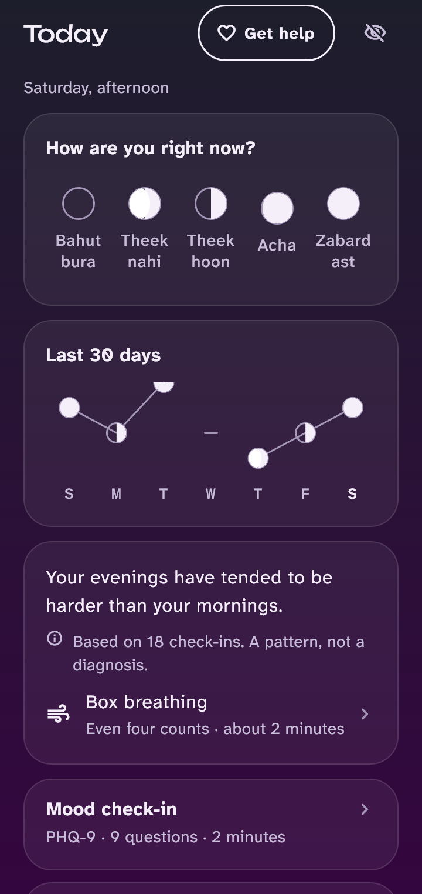
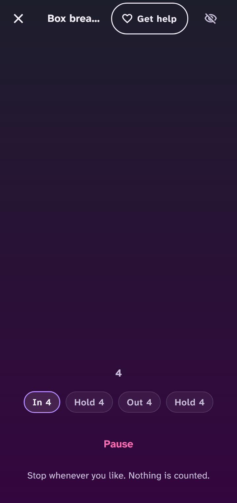
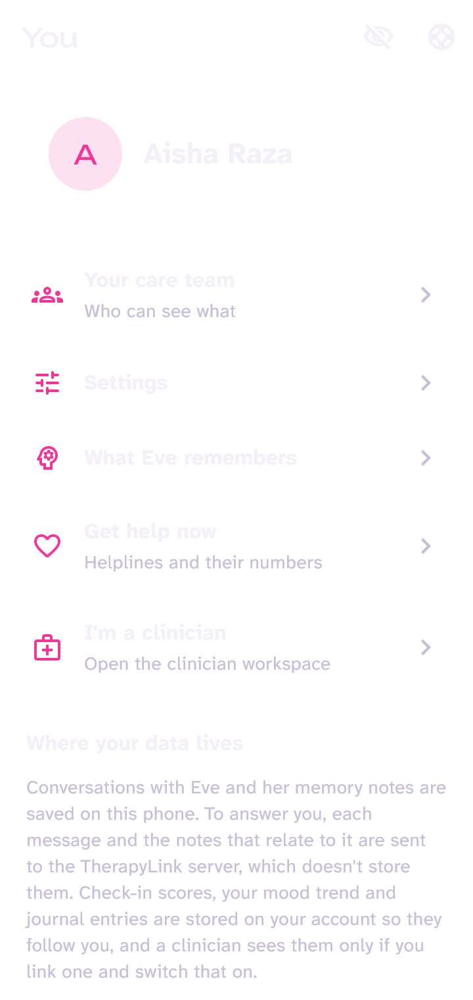
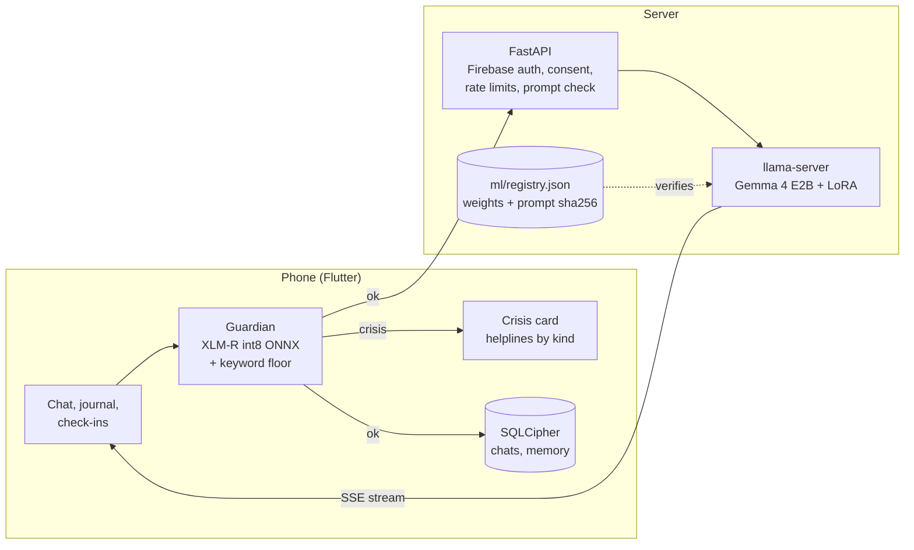

<p align="center">
  
</p>

<h1 align="center">TherapyLink</h1>

<p align="center">
  A mental-health companion for English and Roman Urdu speakers in Pakistan.<br>
  A fine-tuned Gemma 4 chats. A crisis classifier on the phone checks every message first.
</p>

<p align="center">
  
  
  
  
  
  <a href="https://github.com/azamali992/therapy-link/actions"></a>
</p>

<p align="center">
  
  
  
  
  
</p>

> **Not for real patients yet.** Every clinical decision in this repo (crisis wording, helpline list, red lines, training rows) was reviewed by AI, not by a licensed clinician. That sign-off is still open. See [Where it stands](#where-it-stands).

## What it is

You talk to **Eve**. She asks one open question at a time, remembers what mattered last week, and runs short exercises inside the chat (paced breathing, 5-4-3-2-1 grounding, tense and release). You can also log mood, keep an encrypted journal, take a PHQ-9 or GAD-7, and link a clinician who sees only what you switch on.

Eve is Gemma 4 E2B with a LoRA adapter trained for this, served from my own llama-server. No third-party chat API. Chats, journal and memories live on the phone in a SQLCipher database.

The part I care most about is what happens before Eve answers. **Guardian**, an XLM-RoBERTa classifier running on the phone, reads each message for crisis (suicide, self-harm, abuse, a child at risk, sexual violence, harm to others, a medical emergency). If it fires, the model is never asked. The person gets a card with the right Pakistani helpline for that kind of crisis, in their own language. This works with no network.

## How it fits together



The phone filters the model's reply too: a foreign helpline number (a 988 or an 800 line) is cut out and replaced with the real ones.

## The models

| | What | Numbers |
|---|---|---|
| **Eve** | Gemma 4 E2B, LoRA, SFT then DPO. Prompt folded into the first user turn. | Latest candidate (DPO v17) names an allowlisted helpline on **65/70** crisis probes, v16 did 49/70. Replies claiming unverified helpline facts: **0/120**, v16 had 47/120. |
| **Guardian** | XLM-RoBERTa base, 7 crisis labels, int8 ONNX, English, Roman Urdu, Urdu script and mixed. | On 1,242 held-out messages the model alone caught **97.2%** of crises, keywords alone **29.6%**, together **97.5%**. A pruned version is 110 MB, down from 278 MB. |
| **Eval harness** | Rule checks for 12 written red lines, 5 samples per probe, worst-of-N, multi-turn probes. | Four candidate adapters failed it and were thrown out. |

Every number above is from my own probes and held-out sets, not an outside benchmark. Guardian's labels were assigned by AI. The training and eval code is in [ml/](ml/), the served prompt and the registry that pins weights by hash are in [ml/registry.json](ml/registry.json).

## Design

The app is called **Jugnu** (firefly) inside: dark first, one job per colour, night `#1D1E2C` fading to plum `#34063F`, pink `#F23598` for the one main button on a screen, lime `#89F336` only for "safe" (a switch that's on, data staying on the phone). Eve is a jasmine bud rendered in Blender, with idle, listening (petals open) and thinking loops. Fonts are bundled (Unbounded, Atkinson Hyperlegible, Noto Nastaliq Urdu), so it looks the same offline. The spec is in [docs/design/DESIGN.md](docs/design/DESIGN.md).

## Repo

| Path | What's in it |
|---|---|
| [`app/`](app/) | Flutter app: Riverpod, go_router, drift + SQLCipher, Firebase Auth. |
| [`api/`](api/) | FastAPI gateway: token checks, consent, server-scored assessments, clinician access log, inference proxy. Postgres in prod, SQLite locally. |
| [`ml/`](ml/) | Data pipeline, Guardian and Eve training, eval harness, model registry. |
| [`ops/`](ops/) | Serving Eve's llama-server from the registry, and a free-tier hosting kit. |
| [`docs/`](docs/) | Design, clinical review, security, QA, plan. Start with [docs/rebuild/PLAN.md](docs/rebuild/PLAN.md). |

About 1,150 tests: 625 app, 186 API, 355 ML. CI runs them per folder and scans the whole history with gitleaks. One test checks that the prompt the app sends is byte for byte the prompt the model was trained on.

## Run it

Windows setup, the API, the model server, the app and the tests are in **[docs/DEVELOPMENT.md](docs/DEVELOPMENT.md)**. The short version for the API:

```powershell
cd api
python -m venv .venv
.venv\Scripts\python -m pip install -e ".[dev]"
copy .env.example .env
.venv\Scripts\alembic upgrade head
.venv\Scripts\uvicorn therapylink_api.main:app --reload
```

The model weights are not in this repo (they're gitignored). `ml/registry.json` lists what the server expects and refuses to start on a hash mismatch.

## Where it stands

Working: the whole app on a real Android phone (chat with streaming, crisis routing, journal, check-ins, assessments, clinician linking, encrypted storage). Email sign-in was wired up last and hasn't been confirmed on the phone yet.

Not done, and I'd rather say so:

- **No licensed clinician has signed off** the crisis copy, helplines, red-line training rows or DPO pairs. Until that happens it stays out of production: the server refuses an unapproved model.
- **Helplines are checked against public sources, not by phone.** Umang's website is down and a 2026 directory lists a different number for it.
- **Guardian is noisy.** It's tuned never to miss a crisis, so it also fires on some ordinary messages ("my boss is stressing me out"). Cutting that without losing recall is an open problem.
- **Roman Urdu is the weak spot** for both models. Eve's Roman Urdu crisis replies pass 17 of 20 checks.
- **On-device Eve is a prototype** (a 2.5 GB GGUF at 15 to 17 tokens a second on a laptop CPU). It hasn't passed the safety comparison or run on a phone, so Eve still answers from the server.
- **Google sign-in** needs the build's signing fingerprint registered in Firebase.

This is a project, not a medical device. If you or someone near you is in danger in Pakistan, call Rescue 1122.

## Licence

No licence file yet, so all rights are reserved until one is added. The base model and the public datasets used for training have their own terms, listed in [ml/](ml/) and the data cards.

More: [CONTRIBUTING.md](CONTRIBUTING.md) · [SECURITY.md](SECURITY.md)
