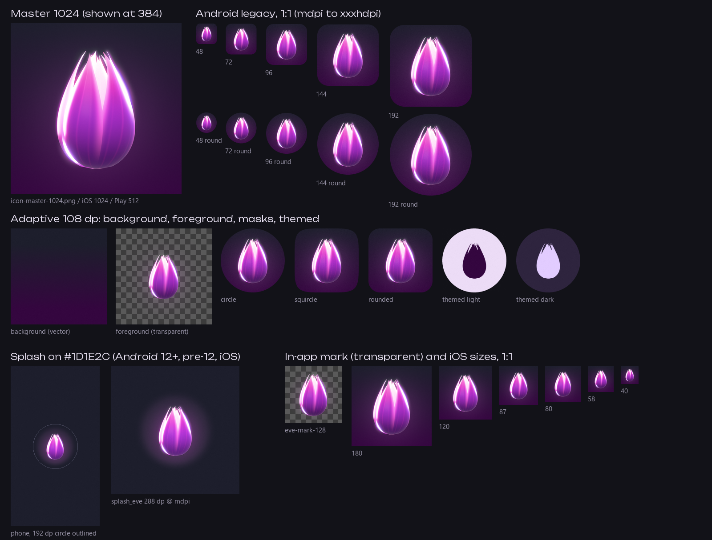
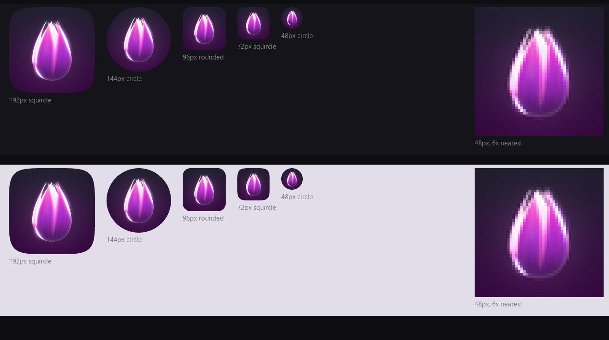

# TherapyLink brand mark

The mark is Eve's bud: the same Blender jasmine/lotus bud as `eve.glb`, rendered straight on with its tips just parting, lit pink and violet, on the Jugnu night ground. There's no wordmark in the icon. The name only appears next to the bud on store art, set in Unbounded Light.





## Files

| What | Where | Size |
|---|---|---|
| Master icon (opaque) | `docs/design/brand/icon-master-1024.png` | 1024 x 1024 |
| Android adaptive icon | `mipmap-anydpi-v26/ic_launcher.xml`, `ic_launcher_round.xml` | XML |
| ... background | `drawable/ic_launcher_background.xml` | vector gradient, 108 dp |
| ... foreground | `mipmap-*/ic_launcher_foreground.png` | 108 dp: 108, 162, 216, 324, 432 px |
| ... monochrome (themed icons, Android 13+) | `mipmap-*/ic_launcher_monochrome.png` | 108 dp, white on transparent |
| Android legacy icons (API 24, 25) | `mipmap-*/ic_launcher.png`, `ic_launcher_round.png` | 48 dp: 48, 72, 96, 144, 192 px |
| Splash bud, Android | `drawable-*/splash_eve.png` | 288 dp: 288 to 1152 px |
| Splash bud, iOS | `Assets.xcassets/LaunchImage.imageset/` | 288 pt @1x, @2x, @3x |
| iOS app icon | `Assets.xcassets/AppIcon.appiconset/` | 20 to 1024 px, 15 files, no alpha |
| In-app mark | `app/assets/brand/eve-mark-512.png`, `eve-mark-128.png` | transparent |
| Play Store icon | `app/assets/brand/store/play-icon-512.png` | 512 x 512, no alpha |
| Play Store feature graphic | `app/assets/brand/store/play-feature-1024x500.png` | 1024 x 500, no alpha |

`store/` is a subfolder on purpose. Flutter asset folders aren't recursive, so listing `assets/brand/` in `pubspec.yaml` bundles the two marks and leaves the store art out of the APK.

## Icon rules

- The ground is night `#1D1E2C` at the top to plum `#34063F` at the bottom, the app's own 180deg ramp. In the adaptive icon the ramp runs across the visible 72 dp only, so the launcher shows the same thing as the master.
- The bud is 50 of the 72 visible dp (69%), centred, nudged 0.6 dp down because the round base is the heavy end. On the 108 dp layer it stays within 25.5 dp of the centre, well inside the 33 dp safe circle, so no launcher mask clips it.
- Glow is one tight rim bloom plus one faint violet aura. No ripple rings, no haze swirl, no motes. Those read as noise below 96 px.
- The tips are parted on purpose. Fully closed, the bud reads as a water drop at 48 px. The notched crown is what makes it a flower.
- The themed (monochrome) icon is the flat silhouette of the same bud, 40 dp tall, no inner lines. Android tints it.

## Clear space and minimum size

- Clear space around the bud: a quarter of the bud's height on every side. Nothing else (text, badges, other marks) goes inside it. The rim glow lives there.
- Launcher icon: 48 px is the floor and it holds up there (see below). Don't make anything smaller than iOS's 20 pt / 40 px Spotlight size.
- In-app mark: 20 dp minimum, which is the chat message label size in DESIGN.md. At 20 to 32 dp put it on the `#1E1F2D` disc. Under 20 dp leave Eve out and use her name in text.

## How it reads at 48 px

The silhouette is clear: a bright pink-violet bud on a dark ground, high contrast on both dark and light wallpapers, with a white rim down the left edge and a violet rim on the right. The crown notches come down to about 2 px and the centre seam to a 1 px line. They're still visible, but at a glance some people will see a pink flame or a drop before they see a bud. From 72 px up it reads as a flower bud without effort.

## Splash

- Background `#1D1E2C` everywhere: Android 12+ `windowSplashScreenBackground`, the pre-12 `launch_background.xml`, `NormalTheme`'s `windowBackground`, the iOS LaunchScreen view, and Flutter's dark ground (`Jugnu.night`). Same hex in all five, so a cold start has no colour jump.
- Android 12+ uses `splash_eve` as `windowSplashScreenAnimatedIcon`: 288 dp canvas, bud 112 dp tall, and all of the glow fades to zero inside the 192 dp circle, so the system's circular clip never shows an edge.
- Pre-12 Android and iOS show the same image centred at its native 288 dp / 288 pt, so the bud is the same size on every version.
- The splash stays dark in light mode too. There are no `values-night` overrides any more. If the app opens in light mode its first Flutter frame is lilac, so that hand-off will change colour once. That's the price of a single night splash, and it's the app's call, not the icon's.

## Do and don't

Do:
- Use the bud as rendered. Rebuild it from the Blender scripts if it needs changing (below).
- Keep it on night/plum. On light screens, put it in the eve well or on the `#1E1F2D` disc (DESIGN.md, Light mode).
- Leave the clear space.

Don't:
- Never put lime `#89F336` on or around Eve. Lime means "a protection is on" and nothing else.
- No face. No eyes, mouth, expression or "sad Eve". The bud never reacts.
- No red anywhere in the mark, the splash or store art.
- Don't recolour the bud, outline it, add a drop shadow, or put it on a photo.
- Don't add the ripple rings or motes back into the icon. They belong to the full Eve render (store feature graphic, welcome hero), not to small sizes.
- Don't set "TherapyLink" inside the icon. The wordmark is store art only.
- Don't stretch, rotate or crop the bud. Don't open the petals further. More open reads as a tulip.

## Rebuilding

Sources live in `D:\therapylink-recovery\design\3d\src\` and are copied to `docs/design/3d-src/`. `icon.py` imports `eve.py`, so the icon is always the current Eve bud.

```sh
cd /d/therapylink-recovery/design/3d/src
bash build.sh brand 'D:\therapylink-v3-wt\brand-assets'
```

That renders `bud.exr` (2048, front orthographic, transparent) and `feature.exr` (1200, full Eve with aura and rings) in Blender 4.5, then `brand.py` composites every PNG above and both review sheets. The feature graphic needs Unbounded at `D:\dev\tools\fonts\Unbounded[wght].ttf` (OFL, from google/fonts `ofl/unbounded`). It isn't in the repo. All geometry is in dp at the top of `brand.py` (`BUD_H`, `MONO_H`, `SPLASH_BUD_H`, `GLOW`).

## Not done here

- `AndroidManifest.xml` has `android:icon` but no `android:roundIcon="@mipmap/ic_launcher_round"`. The round icons exist; whoever owns the manifest needs to add that line.
- `pubspec.yaml` doesn't list `assets/brand/` yet.
